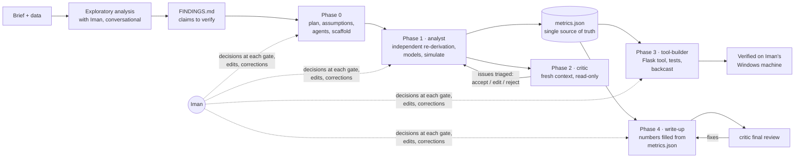

# AI workflow

How AI was used on this take-home, where it fell short, and how its output was checked. The raw audit
trail lives in:
- `prompts/`: versioned prompts and a one-line changelog
- `CLAUDE.md`: repository-level instructions every agent reads first (rules, where context lives, handoffs)
- `.claude/agents/`: agent definitions (v2: inputs, steps, outputs and report formats, do/don't, handoffs)
- `logs/decision_log.csv`: every accept, edit or reject of AI output
- `logs/critic_phase2.md`, `logs/critic_phase4.md`: the two critic reviews and their triage
- Git history: one commit per phase

## Process

## Agent roles, and why only three

| Agent | Role | Tools | Why it exists |
|---|---|---|---|
| **analyst** | Re-derives every FINDINGS.md claim with new code; fits the models; builds `simulate()`; writes every number to `metrics.json` | read/write | Separates producing numbers from presenting them |
| **critic** | Fresh context, never saw the work being produced; returns only an issue table | **read-only** | The work should not grade itself. A reviewer that cannot edit has to argue, not silently fix |
| **tool-builder** | Packages `simulate()` into the tool; may not reimplement the model | read/write | Keeps one copy of the model, tested once |

Three is the smallest set that covers the three things the brief evaluates (analysis, tool, write-up) and
keeps review independent. More agents would mean more hand-offs and lost context for no added assurance at
this size. The analyst and tool-builder roles were run by the main session under their written rules,
because it already held the context. The critic was always a separate fresh-context agent (logged in Phase 1).

## Decision-log summary

89 logged decisions: 64 accepted, 14 edited, 11 rejected.

| Phase | Accept | Edit | Reject |
|---|---|---|---|
| 0 Plan and scaffold | 10 | 3 | 0 |
| 1 Analysis | 6 | 1 | 6 |
| 2 Critic review and fixes | 11 | 2 | 2 |
| 3 Tool | 5 | 2 | 2 |
| 4 Write-up, notebook, final review | 9 | 1 | 1 |
| 5 AI note and follow-ups (sharing, UI, branding, reviews) | 23 | 5 | 0 |

Critic reviews:
- **Phase 2** (analysis): 20 issues. 17 accepted, 2 accepted in modified form, 1 rejected with evidence (a test showed the propensity score is not affected by the offer).
- **Phase 4** (write-up and repo): 15 issues. 14 accepted, 1 edited. The most important were a false "revenue still rising in every segment" claim, the untested jump from ~25% to 100% offer coverage behind the headline, and reporting only the backcast baseline chosen after seeing results.

## What the AI got wrong, and how it was caught

| What went wrong | How it was caught | Fix |
|---|---|---|
| A pooled price × segment model with shared fixed effects gave a wrong retention slope for less-engaged members (−0.06 vs about −0.22) | Compared against raw within-era rates | Separate fits per segment |
| Lapsed customers modelled as a shift on the never-member curve (predicted 66% rejoin at $7 vs 24% observed) | An automatic model-vs-observed fit check | Never-member and lapsed customers fit separately |
| Simulator calibration averaged fixed effects on the log-odds scale (worst cell off by 18.8pp) | The same fit check | Fit directly on the $12 regime (worst cell 2.1pp) |
| EDA claim "deep discounts for all members raise value" used a steady-state formula | Cohort simulation over 12 and 40 quarters, then the critic's point about tenure | Tenure-based member pricing; claim flagged as a MISMATCH, not silently edited |
| Ignored member tenure (new members churn far more) | Critic issue #9 | Three tenure groups in the simulator |
| DiD standard errors far too small with one control region | Critic issue #5 | Sub-region clustering; DiD reported as direction only |
| Extrapolation warnings set on the wrong price range | Critic issue #1 | Ranges taken from the fit sample and stored in `metrics.json` |
| Two of its own checks were built wrong (tenure counter; a sensitivity check charging the wrong price) | Results that did not reconcile | Rebuilt before acting on them |
| Tool failed on Iman's machine (package not installed; Windows reserves port 5000) | Iman ran it | Path handling, automatic port choice, `run_tool.bat`, verified on that machine |
| Hard-typed numbers crept into the tool's HTML; one commit message mis-counted the critic triage | Single-source-of-truth rule; recount | Numbers rendered from `metrics.json`; correction logged |
| Write-up overstated results: "rising in every segment", base cut stated as fact, only the favourable backcast baseline quoted, 100% offer coverage assumed silently | Phase 4 critic | Corrected and labelled; tool warns on offer coverage beyond the tested share |
| Recommendation dropped the randomization that made the analysis possible | Iman | Rewritten as a default offer with a persistent randomized holdout |
| Holdout sized by relative precision only, never by power | Iman | Minimum detectable differences added (sign-up and renewal, 10% vs 5% list arm) |
| Simplified tool dropped the base-price control the brief asks for | Iman | $12-$15 base restored from the two observed eras' tables ($13-$14 blended) |
| Methods heavier than the randomized design needs (fixed-effect logits, IPW, logit DiD, fitted-curve simulator), hard to explain end to end | Iman | Main analysis rebuilt on group averages and a lookup-table projection; models kept as an appendix that agrees on 12 of 12 questions |

## How output was verified

- **Independent re-derivation:** 42 of 46 FINDINGS.md claims reproduced by new code. The 4 that weren't are flagged in `outputs/robustness/findings_verification.csv`.
- **Two methods, same answers:** after the simplification, the simple pipeline and the model-based appendix answer the same 12 questions; all agree in direction (`outputs/robustness/simple_vs_advanced.csv`). The notebook reproduces the key numbers by hand.
- **Randomization checks** before any causal claim: balance, joint tests, AUC ≈ 0.50.
- **Fit check and backcast:** in-sample fit check; backcast out of sample (fit on 2017–18, predict 2019), reported including where it fails (Panem).
- **Tests:** fast tests on every main module (rate tables on hand-made data, projection accounting and validation, policy and power formulas, the tool API), plus the appendix's own tests and one opt-in backcast re-run.
- **Numbers by construction:** every number in the write-up and the tool's text is filled in from `metrics.json`; the build fails on an unknown key.
- **Two independent critic reviews.**
- **Manual run** of the tool on the target Windows machine.

## Limitations of this workflow

- **Not fully independent re-derivation.** The analyst re-derived claims that came from the same overall conversation as the EDA. New code reduces, but doesn't remove, shared blind spots.
- **Same model family.** The critic is the same family of model as the author. It caught real errors, but a human economist's review would catch others.
- **Decisions after seeing results are disclosed, not avoided.** Some analysis choices were made after seeing results (e.g. the backcast baseline, the tenure split). Each is logged, but they were not pre-registered.
