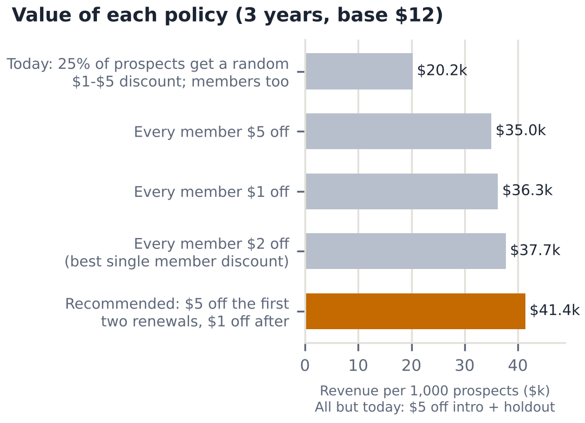

<header class="masthead">

<h1>Lorehaven: were the price changes effective, and what next?</h1>

Immanuel Tacky · Audible Economics, Research &amp; Optimization (AERO) · every number from <code>metrics.json</code>

</header>

<section class="callout" markdown="1">

## Bottom line
- **Discounts work, and the evidence is causal.** Discount size ($1–$5) was randomized, so groups at different prices differ only in price. Who got an offer is assumed random too: the brief says business rules decide it, but nothing observable predicts it (assumption A2). At the $12 base, {{rates.by_price.signup.base12.price12|pct1}} of prospects join at list price and {{rates.by_price.signup.base12.price7|pct1}} with $5 off.
- **The 2019 cut from $15 to $12 likely raised sign-ups, but its size is not pinned down.** List-price sign-up in the cut regions was below Panem in all {{base_cut.quarters_before|int}} quarters before the cut and above it in all {{base_cut.quarters_after|int}} after. Panem is the only comparison, and the gap moved by a few points even without a price change.
- **Recommendation: keep the $12 base. Make a $5 introductory offer the default, with a randomized holdout. Discount members by tenure: $5 off at the first two renewals, $1 off after that.** Projected from the observed rates, giving every new prospect $5 off earns {{headline.recommended_vs_today|pct0}} more revenue per new prospect than today over 3 years ({{headline.recommended_vs_today_h40|pct0}} over 10), and {{headline.recommended_vs_best_single|pct0}} more than the best single member discount. The rollout I recommend keeps a holdout (85% at $5, 10% at list, 5% at $3), worth {{headline.rollout_vs_today|spct0}} vs today ({{headline.rollout_vs_today_h40|spct0}} over 10 years). These gains assume average 2019 conditions and that people respond the same when every prospect gets an offer as when a quarter did.

</section>

## How I evaluated it
Lorehaven re-priced customers by a random draw: inside the discounting regions, whether a prospect got an offer (25%) and its size (an equal share at each of $1–$5) were random, and the groups are balanced on every observable (propensity scores, ad exposure, history, sub-region, quarter). So **the difference between two group averages is the effect of price**, with no model needed. I report sign-up rates for prospects and stay rates for members at each price, by segment and tenure, with counts (every cell has at least 556 customer-quarters). For the $12 cut, which was not randomized, I compared list-price sign-up in the cut regions with Panem, which never changed price. To compare policies over time, a projection follows 1,000 new prospects quarter by quarter: new members = prospects × sign-up rate at their price; members kept = members × stay rate for their tenure and price. It only looks up observed rates (2019 at the $12 base; 2017–18 at $15), so it never goes beyond tested prices. As a cross-check, regression models (fixed-effect logits, inverse-propensity weighting, a fitted-curve simulator) answer the same {{crosscheck.questions|int}} questions in <code>robustness/</code>: all {{crosscheck.same_direction|int}} agree in direction, and sizes differ by at most {{crosscheck.largest_relative_gap|pct0}}.

## Findings

<figure><figcaption><b>Fig. 1.</b> Warm listeners bring the most sign-ups; most joiners are new.</figcaption></figure><figure><figcaption><b>Fig. 2.</b> New members respond most to price.</figcaption></figure>

**1. A $5 offer mostly wins people who would not otherwise join (Fig. 1).** At the $12 base, {{segment.warm_listener.incremental_share_at_5|pct0}} of warm listeners who join with $5 off would not have joined at list price (join rate at $5 off minus at list, over join rate at $5 off; assumes nobody is put off by an offer). It is {{segment.win_back.incremental_share_at_5|pct0}} for win-backs (engaged former members) and {{segment.cold.incremental_share_at_5|pct0}} for the "cold" majority with low podcast engagement. The discount is only paid by those who join, so every segment earns more in its first quarter with an offer. First-quarter revenue per prospect is {{first_quarter.today|usd2}} today and {{first_quarter.everyone_5_off|usd2}} if everyone got $5 off (the average of the random $5 groups, weighted by segment size). Tuning the discount by segment adds little ({{first_quarter.best_discount_per_segment|usd2}}).

**2. Established members mostly stay anyway; new members are the price-sensitive ones (Fig. 2).** At $11, {{rates.stay.base12.high_podcast.established.price11|pct0}} of established engaged members stay, against {{rates.stay.base12.high_podcast.first_renewal.price11|pct0}} at their first renewal. For less-engaged members at their first renewal, the share who stay rises from {{rates.stay.base12.low_podcast.first_renewal.price11|pct0}} at $11 to {{rates.stay.base12.low_podcast.first_renewal.price7|pct0}} at $7. Today every member gets a random $1–$5 discount every quarter, which spends most of the member budget on people who would stay at a higher price.

**3. The $12 base cut likely raised sign-ups, but its size is not pinned down.** Comparing the same seasons of 2018 and 2019, list-price sign-up in the cut regions rose {{base_cut.change_vs_panem|pp1}} more than in Panem. But before the cut, quarter by quarter, the gap to Panem already ranged from {{base_cut.gap_before_min|pp1}} to {{base_cut.gap_before_max|pp1}} with no price change, so a few points of that could be noise in the one comparison region. The direction is clear (below Panem in every quarter before, above in every quarter after); the size is not.

## Recommendation

<figure><figcaption><b>Fig. 3.</b> Tenure-based member discounts earn the most.</figcaption></figure>

1. **Keep the base at $12.** Projected with the 2017–18 rates from the $15 era, the same discounts at a $15 base earn {{headline.recommended_at_15_vs_12|spct0}} vs $12 (the tool blends $13 and $14 between the two). The eras differ in more than price, so test any further list-price change in a controlled experiment: the same $12 drew {{base_cut.offer_rate_2018_at_12|pct1}} sign-up as a $3 discount on $15 but {{base_cut.list_rate_2019_at_12|pct1}} as the list price.
2. **Make a $5 introductory offer the default, and keep a persistent randomized holdout.** $5 is the largest discount tested, and first-quarter revenue was still rising at $5 for never-members (most prospects). The random 25% offer is what made this analysis possible, so keep randomizing: about 85% of new prospects get $5 off, 10% stay at list price, and 5% test $3. Projected value: {{headline.rollout_revenue_per_1000|k1}} per 1,000 prospects over 3 years, against {{policy.recommended.revenue_per_1000_prospects|k1}} with no holdout. **Is 10% enough?** At today's traffic (about {{holdout.prospects_per_quarter|int}} prospects a quarter), the list arm detects a {{holdout.mde_signup_list10_q1|pp1}} sign-up difference in one quarter (the real one is {{holdout.signup_gap_list_vs_5_off|pp1}}), and a {{holdout.mde_renewal_list10_q3|pp1}} renewal difference within three quarters (80% power, 5% significance). Renewal is the open question, so 10% is right for the first quarters; 5% would do after that. The cost is about {{holdout.cost_per_prospect_quarter|usd2}} per prospect-quarter.
3. **Price members by tenure: $5 off at the first two renewals, $1 off after that** (Fig. 3). Over 3 years this yields {{policy.recommended.revenue_per_1000_prospects|k1}} per 1,000 new prospects against {{policy.today.revenue_per_1000_prospects|k1}} today, and the ranking holds over 10 years.
4. **Hold win-back offers to a test arm.** The projection credits them ({{headline.recommended_with_win_back_vs_today|spct0}} vs today), but it cannot see customers who cancel in order to collect one.
5. **Keep randomized arms for members and for list-price changes.** Include some established members at full price, which was never tested. Stagger future base-price changes across regions rather than changing all but one.

**Guardrails to watch.** Revenue per member-quarter barely moves ({{policy.recommended.average_revenue_per_member_quarter|usd2}} vs {{policy.today.average_revenue_per_member_quarter|usd2}}). Average churn rises ({{policy.recommended.average_quarterly_churn|pct1}} vs {{policy.today.average_quarterly_churn|pct1}}) because the member base holds more new members. Discounts given away roughly double ({{policy.recommended.discount_cost_per_1000|k1}} vs {{policy.today.discount_cost_per_1000|k1}} per 1,000 prospects), and they buy {{policy.recommended.members_at_end_per_1000|int}} members at the end against {{policy.today.members_at_end_per_1000|int}}.

**Before production.** Assign arms once per customer (a salted hash of customer ID) and keep them. Log the assigned and the delivered offer and the price paid, tagged with the policy version. Monitor sign-up, churn, discount cost and arm balance against preset thresholds. Keep a one-switch rollback to today's policy.

**Limits.** The projection reuses the average 2019 quarter forever (no seasonality or marketing changes), so it ranks policies rather than forecasting revenue. Standard errors here treat customer-quarters as independent; customers repeat, so true errors are somewhat larger (the appendix reports clustered ones). Whether a deep offer only pulls sign-ups forward cannot be measured from this data; the persistent holdout measures it directly. Revenue is net of discounts; content costs are excluded.

## How I used AI

I used Claude (agentic, with three role-scoped agents: analyst, a read-only critic with fresh context, and a tool-builder), with every prompt versioned and every accepted, edited or rejected suggestion logged (<code>logs/decision_log.csv</code>). <b>Where it fell short:</b> the first models pooled segments with shared fixed effects (a wrong retention slope for less-engaged members), valued members with a steady-state formula that ignored tenure and re-joining, and one sensitivity check charged lapsed customers the wrong price. The critic raised 20 issues; 17 were accepted, 2 modified and 1 rejected with evidence. <b>Simplification:</b> the first version leaned on regression machinery that the randomized design does not need. I rebuilt the main analysis on group averages and a lookup-table projection so every step can be checked by hand, and kept the model-based version as an appendix that confirms it. <b>How I verified:</b> fast tests on every module (synthetic data for the rate tables, accounting checks for the projection), the simple-vs-model comparison above, and every number in this note filled in from <code>metrics.json</code> by the build script.

