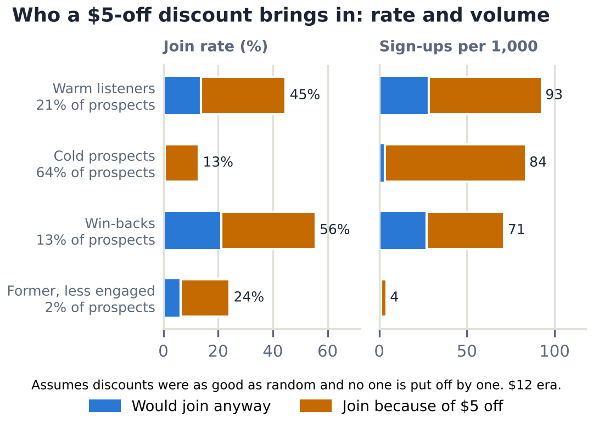
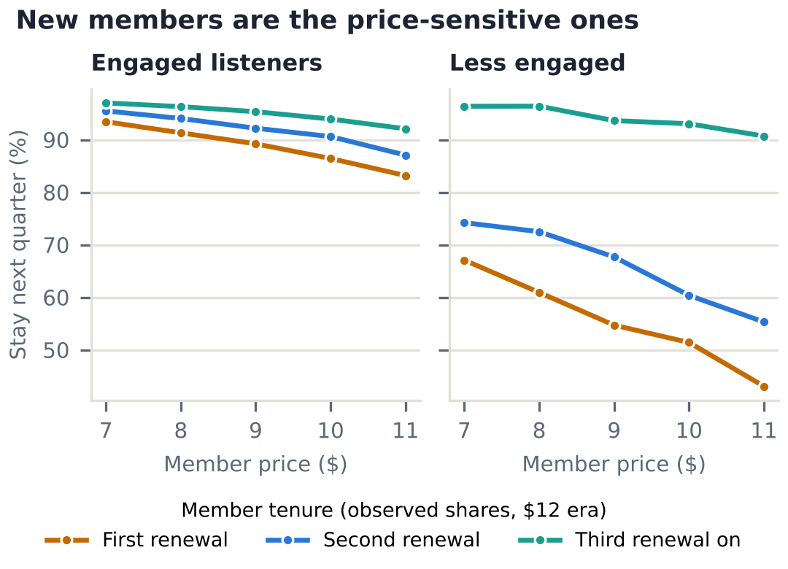

<header class="masthead">

<h1>Lorehaven: were the price changes effective, and what next?</h1>

Immanuel Tacky · Audible Economics &amp; Data Science take-home · every number generated from <code>metrics.json</code>

</header>

<section class="callout" markdown="1">

## Bottom line
- **Discounts work, and the evidence is causal.** Discount depth ($1–$5) was randomized by design. Who got an offer is assumed random: the brief says business rules decide it, but no observable predicts it (assumption A2). Each $1 off raises the odds of signing up by {{headline.signup_odds_change_per_dollar_off|pct0}} and the odds of a member staying by {{headline.retention_odds_change_per_dollar_off|pct0}}.
- **The 2019 cut from $15 to $12 is consistent with higher sign-ups, but it is not cleanly identified.** Panem is the only comparison region and its trends were not parallel before the cut. The best-identified size is what the randomized price curve implies for $3 ({{did.randomized_prediction_delta|num2}} log-odds).
- **Recommendation: keep the $12 base. Replace the random 25% offer with a $5 introductory offer for every new prospect. Discount members by tenure: $5 off at the first two renewals, $1 off after that.** In simulation this earns {{headline.ltv_recommended_vs_today_pct|pct0}} more revenue per new prospect than today's policy over 3 years ({{headline.ltv_recommended_vs_today_pct_h40|pct0}} over 10), and {{headline.ltv_recommended_vs_best_uniform_pct|pct0}} more than the best single member discount. It assumes people respond the same when every prospect gets an offer as when about a quarter did, so the rollout should test this.

</section>

## How I evaluated it
Customers were re-priced every quarter by a random draw, so comparing customers in the same region and quarter at different prices identifies the effect of price, with no parallel-trends assumption needed. Inside the discounting regions, offer eligibility (25% of prospects) and depth (20% at each of $1–$5) are balanced on every observable: propensity scores, ad exposure, history, sub-region, quarter and customer-ID patterns. I fit logit models of sign-up (prospects) and retention (members) on price, with region × quarter fixed effects and customer-clustered errors. Elasticities range from {{elasticity.acquisition.price7|num2}} to {{elasticity.acquisition.price15|num2}} for sign-up and {{elasticity.retention.price7|num2}} to {{elasticity.retention.price14|num2}} for retention, (under a logit, elasticity grows with price by construction). For the $12 cut, I compared list-price prospects in the cut regions against Panem, which never had discounts. To compare policies, a simulator follows a cohort of 1,000 new prospects for 12 quarters using response curves fit on the 2019 $12 regime.

## Findings

**1. A $5 offer mostly wins people who would not otherwise join (Fig. 1).** At the $12 base, {{uplift.base12.warm_listener.incremental_share_at_5|pct0}} of warm listeners who join with $5 off would not have joined at list price. The figure is {{uplift.base12.win_back.incremental_share_at_5|pct0}} for win-backs (former members) and {{uplift.base12.cold.incremental_share_at_5|pct0}} for the "cold" majority with low podcast engagement. Because the discount is only paid by those who join, every segment earns more in its first quarter with an offer than without one. Targeting by segment adds nothing measurable. Using the logged random assignment, first-quarter revenue per prospect is {{ope.status_quo_random_25pct.first_quarter_revenue|usd2}} under today's policy, {{ope.offer_all_5_off.first_quarter_revenue|usd2}} for a uniform $5 offer, and {{ope.targeted_depth.first_quarter_revenue|usd2}} for a segment-tuned offer (standard error about {{ope.offer_all_5_off.first_quarter_revenue_se|usd2}}).

**2. Established members mostly stay anyway; new members are the price-sensitive ones (Fig. 2).** At $11, {{fit_check_in_sample.high_podcast.member_established.price11.observed|pct0}} of established engaged members stay, against {{fit_check_in_sample.high_podcast.member_first_renewal.price11.observed|pct0}} at their first renewal. For less-engaged members, first-renewal retention rises from {{fit_check_in_sample.low_podcast.member_first_renewal.price11.observed|pct0}} at $11 to {{fit_check_in_sample.low_podcast.member_first_renewal.price7.observed|pct0}} at $7. Today every member gets a random $1–$5 discount every quarter, which spends most of the member discount budget on people who would stay at a higher price.

**3. The $12 base cut is consistent with higher sign-ups, but not cleanly identified.** List-price sign-up in the cut regions jumped relative to Panem in the first quarter after the cut ({{event_study.treated_x_q9|num2}} log-odds), then faded to {{event_study.treated_x_q11|num2}} two quarters later. The first-quarter jump is far larger than the randomized curve implies for a $3 cut ({{did.randomized_prediction_delta|num2}}), which points to a shock in the same quarter. Pre-cut differences were not stable either (pre-trend p < 0.001). Descriptively, comparing 2019 with the same seasons of 2018: revenue per customer rose {{headline.base_cut_treated_revenue_per_customer_quarter_change_pct|spct0}} in the cut regions against {{headline.base_cut_panem_revenue_per_customer_quarter_change_pct|spct0}} in Panem. Members per customer rose {{headline.base_cut_treated_members_per_customer_quarter_change_pct|spct0}}, which more than offset a {{headline.base_cut_treated_revenue_per_member_quarter_change_pct|spct0}} change in revenue per member. Panem's trend is the only comparison, so this is supporting evidence, not proof.

## Recommendation

1. **Keep the base at $12.** The model is calibrated there. Test any further list-price change in a controlled experiment rather than taking it from the model: in the data, the same price drew different responses as a discount and as a list price.
2. **Make a $5 introductory offer the default, and keep a persistent randomized holdout.** $5 is the largest discount tested. First-quarter revenue was still rising at $5 for never-members (most prospects); for former members it peaks at $4. The random 25% offer is what made this analysis possible, so keep randomizing: offer about 85% of new prospects $5 off, keep about 10% at list price, and test other depths (e.g. $3, $7) on about 5%. Assign each prospect once and log the assignment. Compared with today's logged shares, this makes the $5-vs-list estimate more precise (standard error ×{{headline.holdout_design_se_ratio_vs_today|num2}}), at a cost of about {{headline.holdout_cost_per_prospect_quarter_at_10pct|usd2}} per prospect-quarter. A persistent holdout also measures long-run incremental revenue directly, pull-forward included. Keep a holdout within any segment you target.
3. **Price members by tenure: $5 off at the first two renewals, $1 off after that** (Fig. 3). Over 12 quarters this yields {{scenario.prospects_5_off_no_winback_new_5_off_established_1_off.ltv_per_1000_prospects|k1}} per 1,000 new prospects against {{scenario.status_quo_2019.ltv_per_1000_prospects|k1}} today. The result holds over 40 quarters ({{headline.ltv_recommended_vs_today_pct_h40|spct0}} vs today) and with or without win-back offers.
4. **Hold win-back offers to a test arm.** The model credits them ({{headline.ltv_recommended_with_winback_vs_today_pct|spct0}} vs today), but it cannot see customers who cancel in order to collect one.
5. **Keep randomized arms for members and for list-price changes.** Give a small share of members random depths, including some established members at full price, which was never tested. Stagger future base-price changes across regions rather than changing all regions but one.

**Guardrails to watch.** Revenue per member-quarter barely moves ({{scenario.prospects_5_off_no_winback_new_5_off_established_1_off.average_revenue_per_member_quarter|usd2}} vs {{scenario.status_quo_2019.average_revenue_per_member_quarter|usd2}}). Average churn rises ({{scenario.prospects_5_off_no_winback_new_5_off_established_1_off.average_quarterly_churn|pct1}} vs {{scenario.status_quo_2019.average_quarterly_churn|pct1}}) because the member base holds more new, higher-churn members. Discounts given away more than double ({{scenario.prospects_5_off_no_winback_new_5_off_established_1_off.discount_cost_per_1000|k1}} vs {{scenario.status_quo_2019.discount_cost_per_1000|k1}} per 1,000 prospects), and they buy {{scenario.prospects_5_off_no_winback_new_5_off_established_1_off.members_at_end_per_1000|int}} members at the end against {{scenario.status_quo_2019.members_at_end_per_1000|int}}.

**Limits.** Fit only on 2017–18, the simulator's engine predicted 2019 member counts in the discounting regions within {{backcast.out_of_sample_avg_2018.mape_treated|pct0}} on average and missed Panem by {{backcast.out_of_sample_avg_2018.mape_panem|pct0}}. That baseline was chosen after the pre-planned same-season baseline missed the discounting regions by {{backcast.out_of_sample_same_season.mape_treated|pct0}}. Quarterly demand shocks are not predictable, so the tool compares policies rather than forecasting. Pull-forward is small: a deep offer this quarter costs {{headline.pull_forward_offset_share_low_podcast|pct1}}–{{headline.pull_forward_offset_share_high_podcast|pct1}} of its gain in next quarter's sign-ups. Revenue is net of discounts, and content costs are excluded.

## How I used AI

I used Claude (agentic, with three role-scoped agents: analyst, a read-only critic with fresh context, and a tool-builder), with every prompt versioned and every accepted, edited or rejected suggestion logged (<code>logs/decision_log.csv</code>). <b>Where it fell short:</b> the first models pooled segments with shared fixed effects (a wrong retention slope for less-engaged members), valued members with a steady-state formula that ignored tenure and re-joining, and one sensitivity check charged lapsed customers the wrong price. The critic raised 20 issues, including overly precise DiD errors, extrapolation warnings set on the wrong range, and missing tenure effects; 17 were accepted, 2 accepted in modified form, and 1 rejected with evidence. <b>How I verified:</b> {{verification.n_match|int}} of {{verification.n_claims|int}} earlier EDA claims were re-derived independently ({{verification.n_mismatch|int}} flagged, not hidden); there are 59 fast tests (plus one opt-in full re-run) and an out-of-sample backcast; every analysis number in this note is filled in from <code>metrics.json</code> by the build script, and process counts come from <code>logs/</code>. A second critic review of this write-up raised 15 issues, all addressed (<code>logs/critic_phase4.md</code>).

